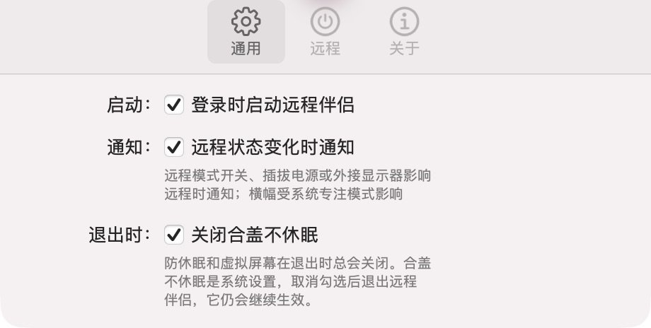

<p align="center">
  
</p>

<h1 align="center">RemoteMate · 远程伴侣</h1>

<p align="center"><strong>远程连接前，一键准备好你的 Mac。</strong></p>
<p align="center">防休眠 · 合盖运行 · 虚拟屏幕 · UU 保活 · 状态通知</p>

<p align="center">
  <a href="https://github.com/erjin-zhi/remote-mate/releases/latest"><strong>下载最新版</strong></a>
  &nbsp; · &nbsp;
  <a href="https://github.com/erjin-zhi/remote-mate/releases">更新日志</a>
  &nbsp; · &nbsp;
  <a href="https://github.com/erjin-zhi/remote-mate/issues">反馈问题</a>
</p>

<p align="center"><sub>macOS 14 及以上 · 菜单栏工具 · 配合远程桌面软件使用</sub></p>

## 核心特性

- **一键准备远程环境**：把防休眠、合盖运行、虚拟屏幕和 UU 启动组合成一键远程模式，按需选择，随时开关。
- **接电、电池分别管理**：独立控制两种供电状态下的防休眠与屏幕常亮，合盖策略随供电设置生效。
- **为远程桌面适配画面**：支持预设与自定义分辨率、30 / 60 / 120 Hz、HiDPI 和主显示器切换；可随外接显示器插拔自动切换虚拟屏幕，使用电池且未开启电池防休眠时自动暂停，供电允许后恢复。
- **UU 自动启动与可选保活**：开启远程模式时启动 UU；额外启用保活后，每 10 秒检查主程序，退出后后台重启，不抢焦点。
- **网络与运行状态一目了然**：查看内外网延迟、UU 服务器延迟和主程序状态，未启动时可一键打开。
- **关键变化及时提醒**：远程模式、供电和外接显示器变化影响远程时发送通知，合盖设置或虚拟屏幕失败也能及时发现。
- **日常使用更省心**：独立设置窗口、菜单栏右键菜单、登录启动、启动后自动开启远程模式，以及应用内更新。

## 界面一览

<table>
  <tr>
    <td width="50%" align="center" valign="top">
      <strong>一键远程与实时状态</strong><br><br>
      
    </td>
    <td width="50%" align="center" valign="top">
      <strong>适配你的远程画面</strong><br><br>
      
    </td>
  </tr>
  <tr>
    <td width="50%" align="center" valign="top">
      <strong>按需组合一键远程</strong><br><br>
      
    </td>
    <td width="50%" align="center" valign="top">
      <strong>启动、通知与退出偏好</strong><br><br>
      
    </td>
  </tr>
</table>

<p align="center"><sub>当前源码界面，按功能区域裁切。<a href="docs/images/main-panel.png">查看完整主面板</a> · 下载版本功能以 <a href="https://github.com/erjin-zhi/remote-mate/releases">Release 更新日志</a> 为准。</sub></p>

## 开始使用

1. 从 [Releases](https://github.com/erjin-zhi/remote-mate/releases/latest) 下载 DMG，将 **RemoteMate** 拖入「应用程序」。
2. 打开菜单栏面板，在「设置…」中选择一键远程包含的项目。
3. 点击「开启」，按提示完成授权，再用你的远程桌面软件连接这台 Mac。

合盖不休眠需要管理员授权；运行时保持散热，装包前关闭防休眠。UU 保活默认关闭，启用后手动退出 UU 也会被重新启动；关闭远程模式即可停止保活。退出 RemoteMate 会关闭防休眠与虚拟屏幕，默认恢复合盖休眠，不退出 UU。

RemoteMate 负责准备远程环境；面板状态不代表远程连接已经建立，其他功能也可脱离 UU 独立使用。

## 开发

需要 macOS 14+ 和 Xcode 命令行工具：

```bash
./build.sh
```

产物位于 `build/RemoteMate.app`。详见 [本地安装与开发说明](docs/development.md) · [打包与发布](Updates/README.md)。
