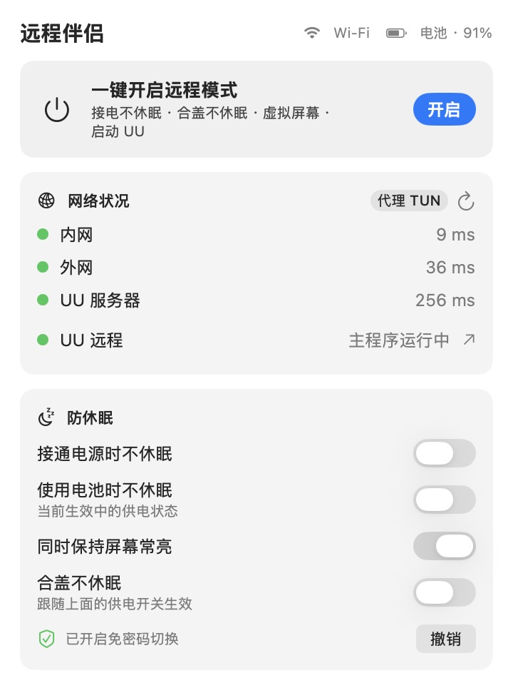
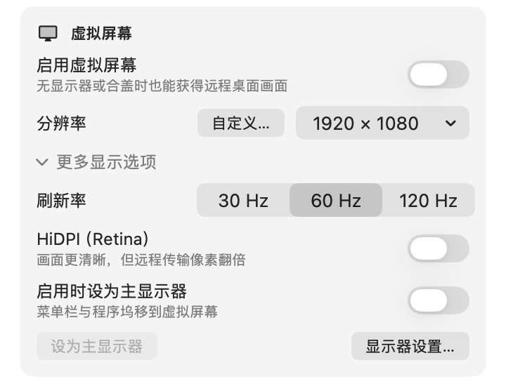
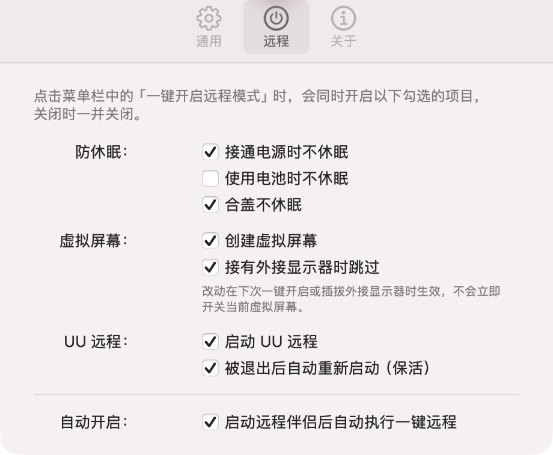

<p align="center">
  
</p>

<h1 align="center">RemoteMate · 远程伴侣</h1>

<p align="center"><strong>远程连接前，一键准备好你的 Mac。</strong></p>
<p align="center">防休眠 · 合盖运行 · 虚拟屏幕 · 网络检测</p>

<p align="center">
  <a href="https://github.com/erjin-zhi/remote-mate/releases/latest"><strong>下载最新版</strong></a>
  &nbsp; · &nbsp;
  <a href="https://github.com/erjin-zhi/remote-mate/releases">更新日志</a>
  &nbsp; · &nbsp;
  <a href="https://github.com/erjin-zhi/remote-mate/issues">反馈问题</a>
</p>

<p align="center"><sub>macOS 14 及以上 · 菜单栏工具 · 配合远程桌面软件使用</sub></p>

## 界面一览

<table>
  <tr>
    <td width="50%" align="center" valign="top">
      <strong>一键准备，状态一目了然</strong><br><br>
      
    </td>
    <td width="50%" align="center" valign="top">
      <strong>按需配置屏幕与启动行为</strong><br><br>
      <br>
      
    </td>
  </tr>
</table>

<p align="center"><sub>v1.2.0 实际界面截图，按功能区域裁切。<a href="docs/images/main-panel.png">查看完整主面板</a></sub></p>

## 能做什么

- **一键远程模式**：按你的选择开启防休眠、合盖运行和虚拟屏幕，也可自动启动 UU 远程；额外勾选「UU 保活」后，主程序退出时会在后台重新启动。
- **灵活防休眠**：分别设置接电、电池和屏幕常亮；合盖不休眠随当前供电设置生效。
- **适配远程画面**：预设或自定义分辨率，支持 30 / 60 / 120 Hz、HiDPI 和主显示器切换；在设置中勾选「接有外接显示器时跳过」后，远程模式会在接入外接显示器时关闭虚拟屏幕，拔掉后自动创建。
- **随时查看状态**：检测内网、外网延迟；安装 UU 远程后，还会显示其服务器延迟和主程序状态，支持一键打开。
- **状态变化通知**：只在影响远程的时刻提醒——远程模式开启或关闭、插拔电源导致防休眠变化、插拔外接显示器触发虚拟屏幕切换，以及合盖设置或虚拟屏幕失败；面板里的手动开关不会重复弹通知。可在「设置…」的「通用」中关闭。
- **减少重复操作**：支持登录启动、启动后自动开启远程模式，以及应用内检查更新。

## 开始使用

1. 从 [Releases](https://github.com/erjin-zhi/remote-mate/releases/latest) 下载 DMG，将 **RemoteMate** 拖入「应用程序」。
2. 打开应用，点击菜单栏图标，点击「设置…」，在「远程」中勾选一键远程包含的项目；右键菜单栏图标也可打开设置、关于和检查更新。
3. 点击「开启」，再用你的远程桌面软件连接这台 Mac。

合盖不休眠需要管理员授权，可选择开启或撤销「免密码授权」。合盖运行时请保持散热，装包前关闭防休眠。退出应用会关闭防休眠和虚拟屏幕，默认恢复合盖休眠。

UU「主程序运行中」仅表示客户端已启动，不代表远程连接已建立。

「UU 保活」默认关闭，需同时勾选「自动启动 UU 远程」并开启远程模式才生效。每 10 秒检查一次，手动退出 UU 也会被重新启动；关闭远程模式或取消任一勾选即可停止保活，不退出已运行的 UU。

远程模式下，切换到电池供电且未开启「使用电池时不休眠」时，虚拟屏幕自动暂停，拔掉外接显示器也不会补建。接回电源或开启电池防休眠后，按外接显示器状态恢复。只纳入虚拟屏幕时顶部显示「已暂停」；还有其他项目开启时显示「部分开启」并说明暂停原因。暂停期间手动关闭最后一个其他项目会退出远程模式，取消待恢复屏幕。

修改「接有外接显示器时跳过」不会立即开关当前虚拟屏幕。需要立即应用时可重新开启远程模式，后续真正插拔外接显示器才会触发自动切换。供电通知会说明虚拟屏幕是否暂停或恢复；合盖切换等待管理员授权时，先通知已确认的变化，授权结束后再补充结果。

如果虚拟屏幕原本就在等待外接显示器断开，切到电池后只会等待供电允许，不提示「虚拟屏幕已暂停」。接回电源时若外接屏仍在，会继续等待其断开，不会立即创建虚拟屏幕。

## 开发

需要 macOS 14+ 和 Xcode 命令行工具：

```bash
./build.sh
```

产物位于 `build/RemoteMate.app`。详见 [本地安装与开发说明](docs/development.md) · [打包与发布](Updates/README.md)。
