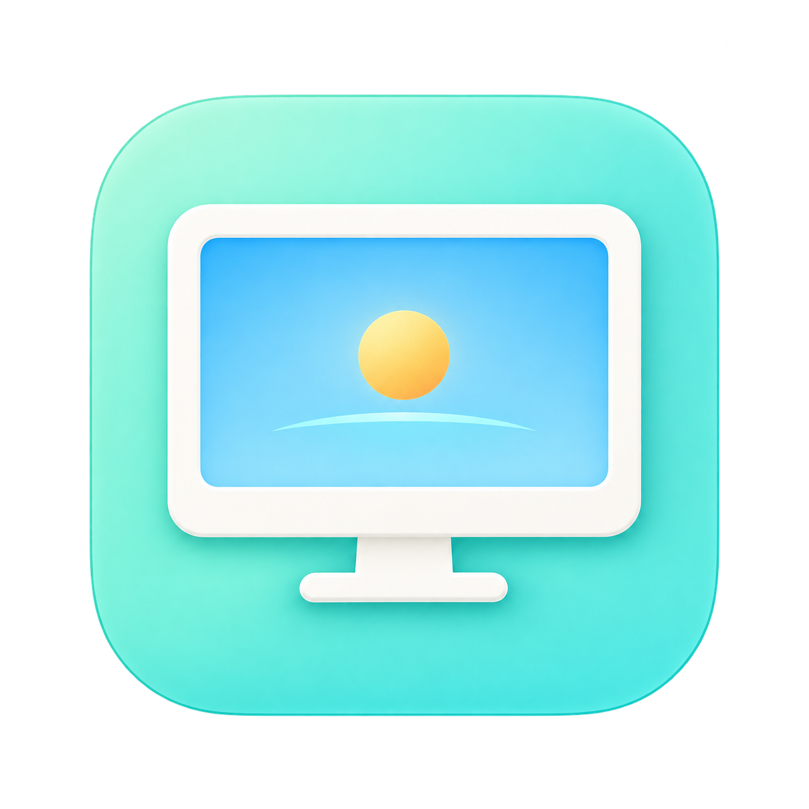

# RemoteMate · 远程伴侣

**为远程连接，一键准备好你的 Mac。**



RemoteMate（中文名：远程伴侣）是一款 macOS 菜单栏工具，提供一键防休眠、虚拟屏幕、网络检查和 UU 远程联动，方便用远程桌面软件连接这台 Mac。

- 英文名：**RemoteMate**
- 中文名：**远程伴侣**
- 项目目录：`remote-mate`
- App 文件名：`RemoteMate.app`；支持英文、简体中文应用显示名称。

## 功能
- **一键远程模式**：同时开启下面勾选的各项（在「偏好设置」中选择包含哪些）
- **接通电源时不休眠 / 使用电池时不休眠**：IOPMAssertion，根据当前供电自动生效，无需权限
- **保持屏幕常亮**：防止远程画面因显示器休眠而黑屏
- **合盖不休眠**：`pmset -a disablesleep 1`，跟随供电生效——接电源时需开启「接通电源时不休眠」，
  用电池时需开启「使用电池时不休眠」，插拔电源自动切换。需要管理员权限；可一次性「免密码授权」
  （在 `/etc/sudoers.d/remote-mate` 写入只允许 `pmset -a disablesleep 0/1` 的规则，可随时撤销）
- **网络状况**：内网（ping 网关）、外网（ping 223.5.5.5）、UU 服务器（HTTPS `api.nrd.nie.163.com`）延迟，
  以及 UU 远程主程序与后台服务状态；ping 绑定物理网卡，绕开代理 TUN
- **一键开启时自动启动 UU 远程**（可在偏好设置关闭；一键关闭不会退出 UU）。每次点击都会重新查询主程序状态，未运行时立即启动，不依赖面板缓存；启动失败会显示原因。
- 仅安装 UU 远程后才检测并显示 UU 服务器延迟与主程序状态；主程序运行不代表已经建立远程连接或一定可被控。
- 「UU 远程」整行悬停显示手型：未启动（包括仅后台服务运行）时显示「打开」按钮；主程序已运行时显示跳转箭头，点击切换到前台。未启动时显示红灯与红色「未启动」，避免将后台服务误认为主程序已运行。
- **虚拟屏幕**：基于 CoreGraphics 私有 API `CGVirtualDisplay`，支持预设/自定义分辨率、30/60/120Hz、HiDPI、设为主显示器
- 登录时启动、启动后自动开启远程模式、退出时恢复合盖休眠

## 构建
```bash
./build.sh
cp -R "build/RemoteMate.app" /Applications/
open "/Applications/RemoteMate.app"
```
需要 macOS 14+、Xcode 命令行工具。

## 图标与命名

- App 图标采用浅薄荷绿底、白色显示器和黄色圆形状态灯，源图为 `Branding/RemoteMate/app-icon-light.png`。
- `Resources/AppIcon.icns` 包含 macOS 所需的多尺寸图标，构建时自动写入 App Bundle，供 Finder 和 DMG 中的应用文件显示。
- 菜单栏使用单色显示器与状态灯：空心表示防休眠和虚拟屏幕均未生效，实心表示至少一项正在生效；它不表示远程会话是否已连接。
- 更新源图后，运行 `./scripts/build-icon.sh` 重新生成 ICNS，然后执行 `./build.sh`。

## 注意
- 合盖不休眠生效时会禁用系统所有休眠；用电池时若开启了「使用电池时不休眠」，装进包里前请关闭，避免过热和耗电。
- 退出应用时，防休眠断言和虚拟屏幕会自动释放；合盖设置默认恢复（可在偏好设置里关掉）。
